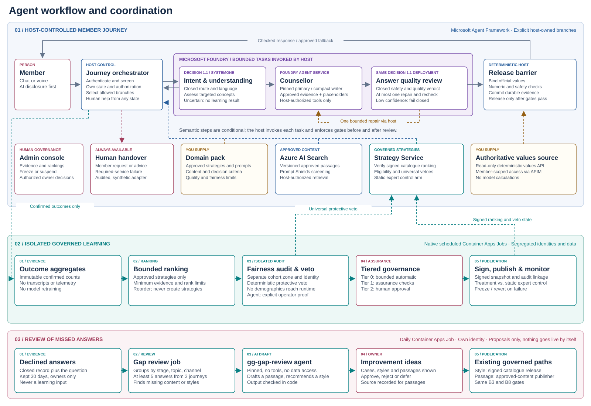

# GovernedGraph
### A governed Learning Member Journey Graph framework: it learns how to explain, never what to decide

> **Efficiency is learned. Fairness is enforced.**

GovernedGraph is a reference framework for building **regulated, member-facing AI guidance** where a
generative model may *explain* official information but must never *decide*, *calculate* or *advise*.
A **Learning Member Journey Graph** learns which *approved* explanation strategy works best for a
journey step, within hard, auditable bounds, and a fairness gate can veto a high-performing strategy for
every member.

The implementation has two layers: **GovernedGraph (GG), the reusable framework**, and
**[pension_wtp](examples/pension_wtp), the bundled sample application**. GG owns the domain-neutral
journey machinery and boundary enforcement; the sample supplies the pension-specific domain pack,
synthetic deterministic values, evaluation cases, demo and release approval. The reference Azure
deployment runs **GG + the selected sample**, not a standalone pension-specific framework.

> **ILLUSTRATIVE - synthetic data.** All sample data is synthetic; no real fund, member or personal
> data is used. The sample gives guidance, not financial or legal advice.

**RAG supplies approved knowledge. The graph selects an approved explanation strategy.**

## The ten boundaries

These are the framework's contract. Each has a code enforcement point and a regression test
([traceability](docs/boundaries-traceability.md)); an adopter should treat weakening any of them as a defect.

| ID | Boundary |
|---|---|
| B1 | Calculations, eligibility, entitlements and official values stay in deterministic systems (read-only, behind a gateway) |
| B2 | Generative AI may explain values but never calculates, rounds, estimates or writes a figure (placeholder binding, 100% numeric-fidelity gate) |
| B3 | Runtime selects only from an approved, versioned strategy catalogue (signed ranking snapshot) |
| B4 | Raw conversations never retrain a model or change behaviour |
| B5 | Learning is bounded continuous ranking of approved strategies only (minimum sample, maximum rank shift, reorder-only) |
| B6 | Fairness can veto a high-performing strategy, for all members |
| B7 | No runtime demographics; demographics exist only in a segregated cohort zone for aggregate audit |
| B8 | Human approval for material change, not for bounded ranking adjustments |
| B9 | Human escalation is always available |
| B10 | The graph must continuously beat governed RAG with static expert ranking (control arm and kill switch) |

Also: guidance, not advice (option-level questions escalate), and an AI disclosure at the start of every session.

## Repository layout

| Path | Role |
|---|---|
| [src/governedgraph](src/governedgraph) | The framework: contracts, guardrails, strategy service, learning, fairness and explainability, orchestrator state machine, agents, search, voice channel and Azure adapters |
| [examples/pension_wtp](examples/pension_wtp) | The sample domain pack and application: data, member-values API, design-depth agents, demo and sample docs |
| [Sample domain pack](examples/pension_wtp/data) | Approved strategies, templates, prompts, vocabulary, content, fairness configuration and synthetic evaluation fixtures |
| [Sample evaluation](examples/pension_wtp/evaluation), [sample tests](examples/pension_wtp/tests) | Pension-specific cases and acceptance checks |
| [Sample deployment definition](examples/pension_wtp/deployment.json), [release approval](examples/pension_wtp/release-approval.json) | Declared sample checks and human-approved writer definition digests |
| [infra](infra) | Azure reference infrastructure (Bicep, `azd`) |
| [tests](tests) | Framework boundary and integration regression tests; full `pytest` discovery also includes the sample tests |
| [evals](evals) | Shared evaluation tools and compatibility entry points; pension acceptance logic lives in the sample |
| [scripts](scripts) | Deployment and operational tooling; the deployment runner consumes the sample definition |
| [docs](docs) | Framework documentation; start with [framework concepts](docs/framework.md) and [adopting it for your domain](docs/adopting.md) |

Framework code never imports the sample (enforced by [the layering test](tests/test_layering.py)).
The sample plugs in through `GOVERNEDGRAPH_DATA_DIR` (the domain pack) and
`GOVERNEDGRAPH_LOCAL_VALUES_PROVIDER` (the local deterministic values source). Repository defaults
select the bundled pension sample for offline use; in Azure, values come through the APIM facade.
Prompts, closed vocabulary and member-facing wording belong to the pack, not framework code.

## How it works

```text
Chat / Voice Live -> authenticated journey orchestrator -> versioned Foundry agents
                             |                               |
                             +-> APIM -> read-only member values
                             +-> approved retrieval (Azure AI Search)
                             +-> Strategy Service (signed ranking + universal vetoes)
                             +-> checked answer -> durable audit -> member

Delivered journey events -> immutable aggregate counts -> bounded ranking + isolated fairness audit
                                                          -> governed signed snapshot
```

[](docs/diagrams/agent-workflow.svg)

*Select the diagram for the full-size view. See the [diagram guide](docs/diagrams/agent-workflow.md) for a step-by-step explanation and editable Mermaid sources.*

Agent Framework executes explicit explanation, clarification, understanding and handover branches.
Separately versioned Intent Routing and Understanding Assessment agents make closed semantic decisions.
The Counsellor agent drafts question-specific explanations; an independent grounded Answer Quality
Judge can require **one bounded repair**. Host code owns authorization, state transitions, approved
strategy structure, official-value placeholder binding, numeric/advice gates and audit-before-release.
Normal answers allow follow-up questions; human handover remains available throughout.

Learning reorders only the approved strategy catalogue, subject to minimum samples and rank-shift
limits. A segregated cohort audit can suspend a strategy **for every member**, even if its overall
performance is strong. The control arm retains static expert ranking; the uplift kill switch can
revert treatment to static ranking. Raw conversations and operational telemetry never train models
or change prompts, content or strategies.

### Components

The framework defines five business agents, not five deployed model definitions:

| Component | Implementation / hosting |
|---|---|
| Member Communication / Counsellor | Foundry prompt agents; Agent Framework orchestration |
| Intent, understanding and answer review | Separate, tool-free Foundry semantic roles supporting the counsellor |
| Fairness & Explainability Agent | Protective Foundry agent plus segregated aggregate cohort audit |
| Journey, values facade and Strategy Service | Container Apps, APIM, private Blob state and Service Bus |
| Approved content and response evidence | Azure AI Search; append-only explainability records in immutable Blob storage |
| P2 bounded learning | Identity-isolated scheduled Container Apps Jobs |
| Transition Calculation, Event Processing, Adoption Guide | Sample-only design-depth contracts and offline stubs, **not deployed administrator integrations** |

See [architecture and deployment details](docs/architecture.md) and the sample's
[design-depth responsibilities and contracts](examples/pension_wtp/docs/agents-design-depth.md).

## Run the sample offline

Use **Python 3.14**, as in CI. No Azure credentials or services are required.

```bash
python -m venv .venv
source .venv/bin/activate                 # Windows: .venv\Scripts\activate
pip install -r requirements.txt
export GOVERNEDGRAPH_MODE=local          # PowerShell: $env:GOVERNEDGRAPH_MODE = "local"
export PYTHONPATH=src:examples           # PowerShell: $env:PYTHONPATH = "src;examples"
pytest
python -m pension_wtp.evaluation.run_evals
python -m pension_wtp.demo.run_demo
```

Run these commands from the repository root. The root command `python evals/run_evals.py` remains
a compatibility entry point to the same sample evaluator, not a second implementation.

The text demo shows the AI disclosure, deterministic figures, approved strategy selection with a fairness suspension,
step-by-step explanation, teach-back, an explainability record and the fairness dashboard.
It also demonstrates idempotent synthetic handover and writes reference-only learning aggregates.
Local semantic decisions use labelled rehearsal fixtures, not a live LLM.

For an evidence-preserving reset use `bash scripts/reset_demo.sh`; add `--presenter` to type the
member's turns. These commands do not reset Azure state or release a protective freeze.
See the [demo runbook](examples/pension_wtp/docs/demo-runbook.md) for rehearsal, output locations and recorded fallbacks.

## Use GG for another domain

Use the pension sample as a worked implementation, not as a dependency of your framework code:

1. Supply a domain pack with approved strategies, placeholder-only templates, prompts, closed
   vocabulary, approved content, expert priors and fairness thresholds.
2. Provide a read-only, member-scoped deterministic values adapter. Select it with
   `GOVERNEDGRAPH_LOCAL_VALUES_PROVIDER=your_package.values:get_member_values` locally; integrate
   the system of record behind APIM in Azure.
3. Keep domain-specific evaluation cases, demo, deployment checks and release approval with your
   application. Preserve GG's boundary tests and pass numeric fidelity, zero option recommendations
   and demographic-invariance gates.

See [adopting GovernedGraph](docs/adopting.md) for the pack layout, configuration and current
portability limits, including strategy IDs and demo/proof expectations that still assume the sample.
Learning is live from day one; it reorders approved strategies and never authors domain content.

## Azure deployment

The Azure implementation supports chat and a voice-first browser presenter with captions and
human handover. Only checked orchestrator text is synthesized. The hosted presenter requires
an authorized operator account; it is not a public demo service.

Deployment uses Azure Developer CLI (`azd`), Bicep, managed identities, private backends and
key/container-scoped access on shared stores. The checked-in
[azd manifest](azure.yaml) includes a **synthetic contact-centre stand-in**, not a production
contact-centre integration. Production needs reviewed external identity, administrator,
contact-centre and content-governance adapters.

Deployment is automated: run `python -m scripts.deploy` (it asks for the subscription, region, resource group name and an on-call
email, then does everything and resumes after a failure); see the [deployment guide](docs/deploying.md) for what it does. Afterwards, retrieve everything environment-specific from the deployment itself rather than from documentation:
`python -m scripts.azd_env show` lists the URLs, names and IDs each operational task needs (and flags anything missing), and
`eval "$(python -m scripts.azd_env export --task <task>)"` exports them to your shell.

The runner defaults to the sample's [deployment definition](examples/pension_wtp/deployment.json):
it runs the declared local tests, sample evaluator and offline demo before provisioning, then requires
the declared deployed channel and voice checks. Use `python -m scripts.deploy --plan` to inspect the
checks, or `--sample-definition examples/pension_wtp/deployment.json` to select the definition explicitly.
Writer approval belongs to the sample release; deployment cannot substitute for human Tier 2 approval.
Offline success alone does not establish live acceptance.

Use the [runbook](examples/pension_wtp/docs/demo-runbook.md#get-your-deployment-details) and the [Azure acceptance](examples/pension_wtp/docs/demo-runbook.md#azure-acceptance) procedure, the [member authentication contract](examples/pension_wtp/docs/api/member-authentication.md)
and [handover operations](examples/pension_wtp/docs/api/contact-centre.md) for prerequisites, configuration and
controlled validation procedures.

## Guardrails and remaining limitations

- **B1-B3:** deterministic values only; placeholder binding and 100% numeric fidelity; approved,
  versioned strategies and verified signed snapshots.
- **B4-B8:** aggregate-only bounded learning; universal fairness vetoes; no runtime demographics;
  human approval for material changes. Protective suspension, freeze and escalation are autonomous.
- **B9-B10, guidance-not-advice, AI disclosure:** human escalation always available; continuous control-arm comparison;
  no option recommendations/comparisons; AI disclosure before input.

Every boundary has [enforcement points and tests](docs/boundaries-traceability.md).
The bundled sample is a synthetic reference, **not a production service**.
Passing local gates is not evidence of full conversational, live integration or production acceptance:

- Conversational quality requires representative evaluation and human review.
- Voice text-channel checks do not certify microphone behavior or end-to-end audio latency.
- Production cost and service-level targets require workload-specific validation.
- Synthetic handover demonstrates the integration contract, not a real advisor callback.
- Transition Calculation, Event Processing and Adoption Guide stubs do not perform real
  administrator actions.

## Documentation map

| Document | Purpose |
|---|---|
| [Framework concepts](docs/framework.md) | The model: planes, roles, the approved-strategy catalogue and the ten boundaries |
| [Adopting GovernedGraph](docs/adopting.md) | Supplying your own domain pack and values source |
| [Architecture](docs/architecture.md) | Runtime/offline flows, persistence, security and production seams |
| [Agent workflow diagram](docs/diagrams/agent-workflow.md) | Agent coordination diagram, step-by-step explanation and editable Mermaid sources |
| [Deploying](docs/deploying.md) | Staged deployment of the reference solution into a new resource group |
| [Evaluation method](docs/evaluation.md) | Hard gates, model-comparison tools and the limits to state with any result |
| [Boundary traceability](docs/boundaries-traceability.md) | B1-B10 enforcement and regression tests |
| [Sample demo runbook](examples/pension_wtp/docs/demo-runbook.md) | Local rehearsal and authorized Azure demo setup |
| [Sample member authentication](examples/pension_wtp/docs/api/member-authentication.md) | Member-scoped access contract |
| [Sample handover integration](examples/pension_wtp/docs/api/contact-centre.md) | Synthetic contact-centre adapter and production integration requirements |
| [Contributor guide](docs/build-with-copilot.md) | Development workflow and documentation conventions |

## Licence

[Apache-2.0](LICENSE); see [NOTICE](NOTICE). Synthetic sample data and content are illustrative only.
