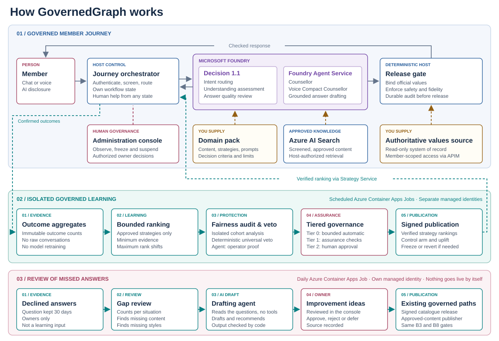

# GovernedGraph
### A framework for governed journey graphs: deterministic facts, bounded learning, auditable controls, and human oversight.

Organisations want AI to help people understand official information (a balance, a status, a rule), but cannot let a model
*make authoritative business decisions*, *calculate* or *advise*. GovernedGraph is a reference framework for exactly that: bounded AI classifies and reviews language, a generative model **explains**,
your deterministic systems **make authoritative decisions**, and a learning loop improves **how** things are explained, inside hard, auditable limits.

> **Terminology.** "Member" is the framework's word for the person being guided; read it as customer, participant, patient,
> citizen or whatever your domain calls them. "Journey" is a multi-step interaction with your organisation, and "official values"
> are any authoritative figure, status or outcome held in a system of record.

## The three ideas

1. **Facts never come from the model.** Official values come from your system of record. The model writes a placeholder such as
   `{{value:<id>}}`; the host fills in the real value and checks it.
2. **Only approved strategies run, and learning only reorders them.** Azure-hosted learning ranks a catalogue of approved
   explanation styles within hard limits. It never writes content and never reads raw conversations.
3. **Quality gates can veto, and humans approve anything that widens.** A cohort audit can remove a strategy for every member.
   Protective actions (suspend, freeze, escalate) are autonomous; anything that widens what the system may say, use or decide
   needs a human.

## How it works

*Select the diagram for the full-size view. For a step-by-step walkthrough of one answer and a glossary, see
[getting started](docs/getting-started.md); for every semantic role and gate, see the
[detailed agent workflow](docs/diagrams/agent-workflow.md).*

## Framework, your domain and the sample

| Part | What it is | Where |
|---|---|---|
| **GovernedGraph** (the framework) | Journey state machine, guardrails, strategy service, learning, quality gates, administration console and Azure adapters. Enforces the ten boundaries | [src/governedgraph](src/governedgraph) |
| **Your domain** | A **domain pack** (strategies, templates, prompts, vocabulary, approved content, quality gates thresholds) and a **values source** (read-only access to your system of record) | `examples/<your_package>` |
| **The sample** | A complete Azure-deployable worked domain (pension-transition guidance for a synthetic Dutch sector fund). Synthetic data only | [examples/pension_wtp](examples/pension_wtp) |

The framework never imports or defaults to a sample ([tested](tests/test_layering.py)).
Domain inputs are explicit. The sample is selected through its deployment composition; it does not enable an offline application runtime.

> **ILLUSTRATIVE - synthetic data.** All sample data is synthetic; no real organisation, member or personal data is used.
> The sample gives guidance, not financial or legal advice.

## Deploy and verify in Azure Public

GovernedGraph executes on Azure Public only. The application requires provisioned Azure
resources, managed identities, a selected domain composition, and approved agent versions.
No local application, in-process service, offline voice or file-backed runtime is provided.

1. Review the [Azure deployment guide](docs/deploying.md) and prepare private delivery inputs.
2. Submit the explicit infrastructure and application deployment using the governed delivery workflow.
3. Verify the deployed applications, identity isolation, Service Bus, Blob, Search, Foundry and admin console.
4. Run synthetic channel probes and the B1-B10 regression suite **in Azure**. Deployment readiness
   does not establish test or evaluation success.

`python -m scripts.deploy --inputs .azure/private-delivery.json` is the deployment
entry point when invoked in an approved Azure-hosted delivery environment. Use
`--plan` for a non-mutating composition review. See the [Azure-only execution contract](docs/azure-only-execution.md)
for the Azure-only test-evidence requirements. The repository does not include
a deployment-dependent GitHub CI workflow: deploy-specific Azure identities, resources
and endpoints are supplied by an authorized operator during deployment, not as
GitHub repository or source-code parameters. Test/evaluation evidence must be
collected separately in the approved Azure environment; an unrun test is not a pass.

## Use it for your own solution

1. Copy `examples/pension_wtp` to `examples/my_domain` and rename the package.
2. Set `GOVERNEDGRAPH_DATA_DIR` explicitly through your deployment composition.
3. Replace the domain pack and the Azure-backed values API with yours.
4. Validate the B1-B10 boundaries and pinned Foundry agents using Azure-hosted jobs.

The framework under `src/governedgraph` stays independent from any sample. See
[adopting](docs/adopting.md) for domain packaging and implementation boundaries.

## The ten boundaries

These are the framework's contract. Each has a code enforcement point and a regression test
(see [architecture](docs/architecture.md)); treat weakening any of them as a defect.

| ID | Boundary |
|---|---|
| B1 | Authoritative values and determinations (calculations, rule-based outcomes, official records) stay in deterministic systems (read-only, behind a gateway) |
| B2 | Generative AI may explain an authoritative value but never calculates, rounds, estimates or writes one (placeholder binding, 100% numeric-fidelity gate) |
| B3 | Runtime selects only from an approved, versioned strategy catalogue (signed ranking snapshot) |
| B4 | Raw conversations never retrain a model or change behaviour |
| B5 | Learning is bounded continuous ranking of approved strategies only (minimum sample, maximum rank shift, reorder-only) |
| B6 | Quality gates can veto a high-performing strategy, for all members |
| B7 | No runtime demographics; demographics exist only in a segregated cohort zone for aggregate audit |
| B8 | Human approval for material change, not for bounded ranking adjustments |
| B9 | Human escalation is always available |
| B10 | Compare against governed RAG with static expert ranking (control arm and kill switch); improvements require measured evidence, not assumption |

Also: guidance, not advice (option-level questions escalate), and an AI disclosure at the start of every session.

## Validation status

**Not production-validated.** GovernedGraph is an Azure Public reference implementation with a synthetic example, not a certified or supported production service. The repository contains regression and evaluation source, but has no mandatory GitHub CI workflow; their presence is not evidence of execution or a pass. The checked-in simulated model-comparison report from 30 October 2026 records a **failed deterministic acceptance gate**, and no subsequent passing end-to-end evidence for the latest `main` was verified during this publication review. Model quality, effectiveness, fairness, latency and operational cost must be measured for a specific deployed workload.

## What this is not

A synthetic reference, **not a production service**. Passing Azure-hosted regression gates is not by itself evidence of conversational quality, live
integration or production acceptance. See the [limits to state with any result](docs/framework.md#limits-to-state-with-any-result).

## Documentation map

| Start here | |
|---|---|
| [Getting started](docs/getting-started.md) | Run it, how one answer is produced, glossary, repository map |
| [Adopting GovernedGraph](docs/adopting.md) | Build on your own domain |
| [Framework concepts](docs/framework.md) | Planes, roles, components, limits |

| Go deeper | |
|---|---|
| [Architecture](docs/architecture.md) | Azure P1/P2 flows, persistence, security and governance boundaries |
| [Administration console](docs/administration.md) | Rankings, vetoes, suspensions, decisions, conversations; protective actions and access control |
| [Deploying](docs/deploying.md) | Governed Azure delivery and teardown |
| [Agent workflow diagram](docs/diagrams/agent-workflow.md) | The detailed semantic roles and gates diagram, step-by-step explanation and editable Mermaid sources |

| The sample | |
|---|---|
| [Demo runbook](examples/pension_wtp/docs/demo-runbook.md) | Authorized Azure synthetic presenter with live AI persona role play and presenter take-over, channel probes and recovery |
| [Member authentication](examples/pension_wtp/docs/api/member-authentication.md), [handover integration](examples/pension_wtp/docs/api/contact-centre.md) | Sample integration contracts |

## Licence

[Apache-2.0](LICENSE); see [NOTICE](NOTICE). Synthetic sample data and content are illustrative only. See [contributing](CONTRIBUTING.md) and [security](SECURITY.md) for collaboration and reporting guidance. Copyright ownership and publication authority must be independently confirmed before changing repository visibility.
