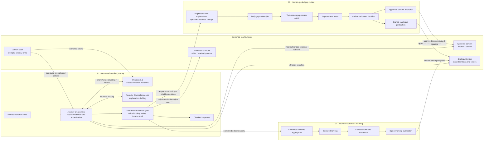

- [Design-depth scope](../../examples/pension_wtp/docs/agents-design-depth.md)
# Agent workflow and coordination

New to the project? Start with the simpler [overview diagram](overview.png), which the README uses:
the framework, what you supply, the people involved and the learning loop in one picture. This page is the detail behind it.

[Vector SVG](agent-workflow.svg) (1600 × 1100, white background). The [approved overview PNG](overview.png) is the canonical first-time-reader image (1671 × 941 pixels), while this page's [detailed workflow SVG](agent-workflow.svg) remains scalable and editable. To export only the detailed workflow as PNG, use `inkscape agent-workflow.svg --export-type=png --export-width=3840 --export-filename=agent-workflow.png`.

The diagram presents the implemented member-guidance workflow and **two complementary improvement loops**: bounded aggregate ranking and separately owner-reviewed gap proposals. It is not an unrestricted agent-to-agent conversation.
All examples and data are **ILLUSTRATIVE - synthetic data**.
Boxes outlined in dashed gold (the approved-content and official-values columns) are what **your domain supplies**:
the domain pack's content and your read-only system of record. The rose box is the [administration console](../administration.md),
where authorized operators observe evidence and can freeze or suspend; separately authorized owners can record governed owner and catalogue decisions.

## How to read the diagram

- **The host coordinates.** Microsoft Agent Framework executes explicit branches.
  The host owns authentication, input screening, state, authorization and release.
- **Semantic work has bounded roles.** Microsoft Decision 1.1 provides intent routing, teach-back understanding and answer-quality review through the direct SystemOne API. The two named Counsellor prompt agents draft explanations using approved evidence and official-value references. The host controls at most one repair and recheck.
- **AI never calculates official values.** The host binds placeholders to the
  read-only deterministic Values API, checks numeric fidelity and advice
  boundaries, and durably records evidence before releasing a response.
  Gates run before review and again after repair/review; the SVG groups them
  at the release barrier for readability.
- **Help is always available.** Clarification, follow-up, teach-back and handover
  are explicit workflow branches. Member requests, personal-advice questions and
  required-service failures can trigger human handover. The contact-centre
  integration is a synthetic stand-in, not a real advisor callback.
- **Learning changes ranking, not knowledge or entitlement.** Only immutable
  outcome aggregates enter bounded reordering of the approved catalogue.
  Raw conversations and operational telemetry are not ranking inputs. A **separate** gap-review workflow handles eligible declined questions under a 30-day retention limit and cannot directly alter runtime behavior.
- **Fairness can veto performance.** The deterministic isolated cohort audit can suspend a
  strategy for all members. The separately authorized fairness prompt agent is retained for explicit operator proof, not the scheduled veto. Runtime receives universal suspensions, never
  demographics or cohort-specific routing.
- **Governance is tiered.** Tier 0 adjustments are automatic within bounds.
  Tier 1 moves require agentic assurance checks. Material changes and
  reinstatement require Tier 2 human approval; they are not automatic outputs
  of the ranking pipeline. Protective actions do not wait for approval.
- **Gap proposals require owner judgment.** The nightly batch detects repeated decline patterns (at least five eligible declines from three journeys), and its tool-free agent drafts candidate passages or styles. It cannot approve or publish them. The owner decides; the catalogue signing path and content publisher are distinct.
- **Publication is not proof of uplift.** After approval and publication, outcomes can be evaluated through the existing governed learning and control-arm mechanisms; uplift monitoring can return treatment to static ranking.

Scope: the pension sample's Transition Calculation, Event Processing and Transition Adoption Guide
remain design-depth contracts/offline stubs. They are intentionally not drawn as
live participants in this workflow.

## Application Architecture

This logical diagram follows **specific read and publication paths**, not a shared bus where every component consumes every source. The deterministic release gate is the only box shown reading the authoritative values facade. The orchestrator uses the signed strategy state; the approved retrieval path supplies evidence to the writing process.

### Technology stack summary

| Layer | Technology | Version policy | Purpose |
|---|---|---|---|
| Coordination | Python, Microsoft Agent Framework | Repository-pinned dependencies | Explicit workflow and host-owned state |
| Closed semantic decisions | Microsoft Decision 1.1 / SystemOne API | Pinned model deployment and domain criteria | Intent, understanding, answer review |
| Explanation | Microsoft Foundry Agent Service | Named agent definitions | Primary and compact Counsellor |
| Approved reads | APIM, AI Search, Strategy Service | Versioned contracts/content/snapshots | Official values, grounded content and governed strategies |
| Evidence and learning | Blob storage, Service Bus, Container Apps Jobs | Versioned schemas and release images | Durable audit, aggregate projection and isolated bounded learning |
| Owner-reviewed improvement | Separate Container Apps Job, tool-free Foundry agent, administration console | Reviewed proposals and owner decisions | Analyze eligible declined explanations; publish only through existing governed paths |

### Data storage and external services

Private Blob storage holds durable journey state, append-only explainability
evidence, immutable aggregates and signed snapshots. Service Bus carries
idempotent domain events. APIM fronts deterministic values and adapter
contracts; Azure AI Search supplies approved knowledge. Production administrator
and contact-centre integrations are not implied by the synthetic adapters.

### Key architectural decisions

- Host enforcement remains authoritative; agent outputs cannot bypass gates.
- Learning and cohort audit are segregated from member-facing runtime.
- Only approved strategies are reordered; universal vetoes apply at read time.

## Component Relationships

```mermaid
flowchart LR
    subgraph Coordination["Host coordination"]
        route["Screen and route"]
        branch["Clarify, explain, assess or hand over"]
        commit["Host gates and evidence commit"]
    end
    subgraph Semantic["Bounded semantic roles; all invoked by host"]
        intent["Decision 1.1 - Intent Routing"]
        understanding["Decision 1.1 - Understanding"]
        writer["Foundry - Counsellor / compact"]
        judge["Decision 1.1 - Answer Review"]
    end
    subgraph Tools["Governed data access"]
        reads["Approved content, official values and signed strategies"]
    end
    subgraph Learning["Scheduled governed learning"]
        outcomes["Outcome aggregate projection"]
        rank["Bounded ranking"]
        fairness["Deterministic isolated fairness audit"]
        assurance["Assurance checks and tier routing"]
        publish["Sign and publish"]
    end
    subgraph Review["Daily review of missed answers"]
        declined["Eligible declined explanations and kept questions"]
        gapjob["Gap review job"]
        drafter["gg-gap-review agent, no tools"]
        ideas["Improvement ideas"]
        contentpublisher["Approved-content publisher"]
    end
    owner["Owner decision in the administration console"]
    route -->|"closed routing decision"| intent
    intent -->|"selected branch"| branch
    branch -->|"teach-back branch"| understanding
    understanding -->|"understood, uncertain or not understood"| branch
    branch -->|"explanation branch"| writer
    writer -->|"host-authorized reads"| reads
    writer -->|"host validates and invokes review"| judge
    judge -.->|"host controls one bounded repair then recheck"| writer
    judge -->|"pass or approved fallback"| commit
    branch -->|"clarification, checked outcome or handover"| commit
    commit -->|"confirmed journey events"| outcomes
    outcomes -->|"immutable counts"| rank
    rank -->|"candidate order"| fairness
    fairness -->|"candidate and veto evidence"| assurance
    fairness -.->|"suspend universally"| reads
    assurance -->|"eligible approved ranking"| publish
    publish -->|"verified snapshot on next read"| reads
    commit -->|"declined answers, question kept 30 days"| declined
    declined --> gapjob
    gapjob -->|"questions, styles, patterns"| drafter
    drafter -->|"checked recommendation"| ideas
    ideas --> owner
    owner -->|"approved style: signed catalogue release"| publish
    owner -->|"approved passage: queued with source"| contentpublisher
    contentpublisher -->|"verified, published content"| reads
```

### Component inventory

| Component | Layer / type | Responsibility |
|---|---|---|
| Journey Orchestrator | Runtime host | Authenticate, screen, maintain state and execute explicit branches |
| Intent Routing | Decision 1.1 | Return a closed routing decision |
| Understanding Assessment | Decision 1.1 | Assess only concepts targeted by the accepted teach-back |
| Counsellor and compact Counsellor | Foundry prompt agents | Draft from approved evidence and value placeholders |
| Answer Quality Review | Decision 1.1 | Check grounding, relevance and language; host controls repair |
| Host gates and evidence commit | Deterministic host | Bind values, enforce safety and audit before release |
| Approved read surfaces | Data-access contracts | Serve approved knowledge, official values and signed strategies |
| Bounded ranking | Scheduled deterministic pipeline | Reorder approved strategies within evidence and shift limits |
| Fairness audit | Scheduled deterministic isolated audit | Apply universal protective vetoes and record evidence |
| Fairness and Explainability | Foundry prompt agent | Explicit separately authorized operator proof; not required for scheduled veto |
| Assurance checks and tier routing | Governed review | Validate Tier 1 moves; reserve material changes for humans |
| Sign and publish | Scheduled host | Publish the governed signed ranking snapshot |
| Gap review job | Scheduled deterministic job | Group declined answers by situation and find missing content or styles |
| Gap review agent (`gg-gap-review`) | Tool-free Foundry prompt agent | Analyse the kept questions, draft a passage and recommend a style; output is checked by code |
| Improvement ideas | Administration console | Owner approves, rejects or defers; approvals use the signed catalogue release and the content publisher |

## Source references

- [Gap-review architecture, eligibility and publication](../architecture-gap-review.md)

- [Decision 1.1 client](../../src/governedgraph/agents/decision_model.py)
- [Semantic decision definitions](../../src/governedgraph/agents/decision_agents.py)
- [Native scheduled jobs](../../src/governedgraph/learning/scheduled_jobs.py)
- [Runtime workflow](../../src/governedgraph/orchestrator/workflow.py)
- [Counsellor, review and release gates](../../src/governedgraph/agents/counsellor.py)
- [Learning workflow](../../src/governedgraph/learning/run_cycle.py)
- [Gap review](../../src/governedgraph/learning/gap_review.py) and [its job](../../src/governedgraph/learning/gap_review_job.py)
- [Assurance checks](../../src/governedgraph/learning/assurance_committee.py)
- [Fairness veto](../../src/governedgraph/agents/fairness_explainability.py)
- [Architecture](../architecture.md)
