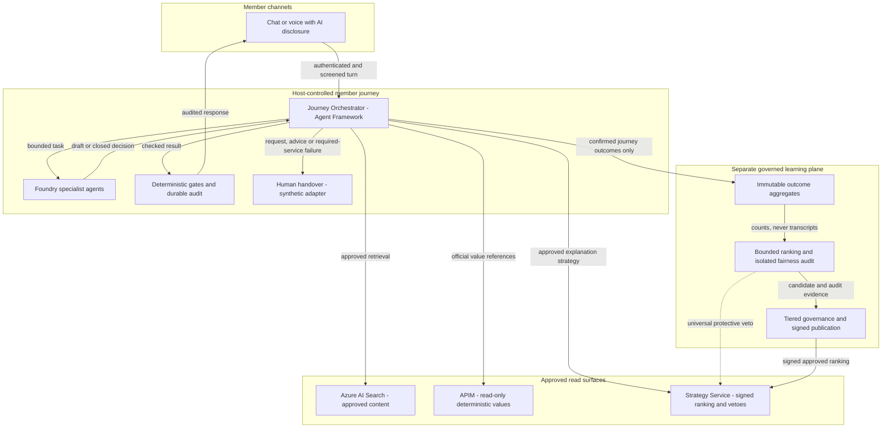

# Agent workflow and coordination

[Vector SVG](agent-workflow.svg): 1920 x 1080, 16:9, white background. It scales
without loss and can be inserted into documents. The
[3840 x 2160 PNG](agent-workflow.png) is a font-independent alternative.

The diagram presents the implemented member-guidance workflow and separate
governed learning loop, not an unrestricted agent-to-agent conversation.
All examples and data are **ILLUSTRATIVE - synthetic data**.

## How to read the diagram

- **The host coordinates.** Microsoft Agent Framework executes explicit branches.
  The host owns authentication, input screening, state, authorization and release.
- **Agents have bounded roles.** Intent Routing selects a closed branch;
  Understanding Assessment evaluates the actual taught concepts.
  The Pension Counsellor explains approved content and official-value references.
  The independent Answer Quality Judge may request one repair and recheck.
- **AI never calculates official values.** The host binds placeholders to the
  read-only deterministic Values API, checks numeric fidelity and advice
  boundaries, and durably records evidence before releasing a response.
  Gates run before review and again after repair/review; the SVG groups them
  at the release barrier for readability.
- **Help is always available.** Clarification, follow-up, teach-back and handover
  are explicit workflow branches. Member requests, personal-advice questions and
  required-service failures can trigger human handover. The contact-centre
  integration is a synthetic stand-in, not a real advisor callback.
- **Learning changes ranking, not knowledge or entitlement.** Only immutable
  outcome aggregates enter bounded reordering of the approved catalogue.
  Raw conversations and operational telemetry are not learning inputs.
- **Fairness can veto performance.** The isolated cohort audit can suspend a
  strategy for all members. Runtime receives universal suspensions, never
  demographics or cohort-specific routing.
- **Governance is tiered.** Tier 0 adjustments are automatic within bounds.
  Tier 1 moves require agentic assurance checks. Material changes and
  reinstatement require Tier 2 human approval; they are not automatic outputs
  of the ranking pipeline. Protective actions do not wait for approval.
- **Publication is not proof of uplift.** The control arm retains expert ranking;
  uplift monitoring can return treatment to static ranking.

Scope: Transition Calculation, Event Processing and Transition Adoption Guide
remain design-depth contracts/offline stubs. They are intentionally not drawn as
live participants in this workflow.

## Application Architecture

### Technology stack summary

| Layer | Technology | Version policy | Purpose |
|---|---|---|---|
| Coordination | Python, Microsoft Agent Framework | Repository-pinned dependencies | Explicit workflow and host-owned state |
| Agent reasoning | Microsoft Foundry Agent Service | Versioned agent definitions | Bounded semantic decisions and explanations |
| Approved reads | APIM, AI Search, Strategy Service | Versioned contracts/content/snapshots | Official values, grounded content and governed strategies |
| Evidence and learning | Blob storage, Service Bus, Container Apps Jobs | Versioned schemas and release images | Durable audit, aggregate projection and isolated learning |

### Data storage and external services

Private Blob storage holds durable journey state, append-only explainability
evidence, immutable aggregates and signed snapshots. Service Bus carries
idempotent domain events. APIM fronts deterministic values and adapter
contracts; Azure AI Search supplies approved knowledge. Production administrator
and contact-centre integrations are not implied by the synthetic adapters.

### Key architectural decisions

- Host enforcement remains authoritative; agent outputs cannot bypass gates.
- Learning and cohort audit are segregated from member-facing runtime.
- Only approved strategies are reordered; universal vetoes apply at read time.

## Component Relationships

```mermaid
flowchart LR
    subgraph Coordination["Host coordination"]
        route["Screen and route"]
        branch["Clarify, explain, assess or hand over"]
        commit["Host gates and evidence commit"]
    end
    subgraph Semantic["Bounded agent roles"]
        intent["Intent Routing"]
        understanding["Understanding Assessment"]
        writer["Pension Counsellor"]
        judge["Answer Quality Judge"]
    end
    subgraph Tools["Governed data access"]
        reads["Approved content, official values and signed strategies"]
    end
    subgraph Offline["Governed learning"]
        outcomes["Outcome aggregate projection"]
        rank["Bounded ranking"]
        fairness["Fairness and Explainability"]
        assurance["Assurance checks and tier routing"]
        publish["Sign and publish"]
    end
    route -->|"closed routing decision"| intent
    intent -->|"selected branch"| branch
    branch -->|"teach-back branch"| understanding
    understanding -->|"understood, uncertain or not understood"| branch
    branch -->|"explanation branch"| writer
    writer -->|"host-authorized reads"| reads
    writer -->|"host-validated draft"| judge
    judge -.->|"one bounded repair then recheck"| writer
    judge -->|"pass or approved fallback"| commit
    branch -->|"clarification, checked outcome or handover"| commit
    commit -->|"confirmed journey events"| outcomes
    outcomes -->|"immutable counts"| rank
    rank -->|"candidate order"| fairness
    fairness -->|"candidate and veto evidence"| assurance
    fairness -.->|"suspend universally"| reads
    assurance -->|"eligible approved ranking"| publish
    publish -->|"verified snapshot on next read"| reads
```

### Component inventory

| Component | Layer / type | Responsibility |
|---|---|---|
| Journey Orchestrator | Runtime host | Authenticate, screen, maintain state and execute explicit branches |
| Intent Routing | Semantic agent | Return a closed routing decision |
| Understanding Assessment | Semantic agent | Assess only concepts targeted by the accepted teach-back |
| Pension Counsellor | Explanation agent | Draft from approved evidence and value placeholders |
| Answer Quality Judge | Independent semantic agent | Check grounding, relevance and language; bound repair |
| Host gates and evidence commit | Deterministic host | Bind values, enforce safety and audit before release |
| Approved read surfaces | Data-access contracts | Serve approved knowledge, official values and signed strategies |
| Bounded ranking | Offline deterministic pipeline | Reorder approved strategies within evidence and shift limits |
| Fairness and Explainability | Protective agent and isolated audit | Apply universal vetoes and open governance cases |
| Assurance checks and tier routing | Governed review | Validate Tier 1 moves; reserve material changes for humans |
| Sign and publish | Offline host | Publish the governed signed ranking snapshot |

## Source references

- [Runtime workflow](../../src/governedgraph/orchestrator/workflow.py)
- [Counsellor, review and release gates](../../src/governedgraph/agents/counsellor.py)
- [Learning workflow](../../src/governedgraph/learning/run_cycle.py)
- [Assurance checks](../../src/governedgraph/learning/assurance_committee.py)
- [Fairness veto](../../src/governedgraph/agents/fairness_explainability.py)
- [Architecture](../architecture.md)
- [Design-depth scope](../../examples/pension_wtp/docs/agents-design-depth.md)
